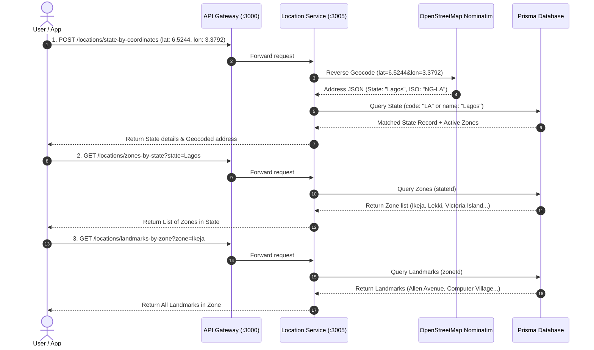

# 📍 Location & Geocoding APIs — User Documentation

Welcome to the **PickAm Location & Geocoding API Guide**. This document details the location discovery endpoints designed for end-users (customers, riders, and frontend client apps).

These APIs enable clients to:
1. Convert GPS coordinates (latitude & longitude) into a state using **OpenStreetMap Nominatim** reverse geocoding and match it against system database records.
2. Query all delivery zones configured for a given state.
3. Query all registered landmarks within a delivery zone.

---

## 🚀 Quick Overview

| # | Feature | Method | Endpoint | Query Parameters | Body (JSON) |
|---|---|---|---|---|---|
| **1** | **Coordinates → State** | `GET` / `POST` | `/locations/state-by-coordinates` | `latitude`, `longitude` (or `lat`, `lng`, `lon`) | `{"latitude": 6.5244, "longitude": 3.3792}` |
| **2** | **State → Zones** | `GET` / `POST` | `/locations/zones-by-state` | `stateId`, `state`, or `stateName` | `{"state": "Lagos"}` or `{"stateId": "uuid"}` |
| **3** | **Zone → Landmarks** | `GET` / `POST` | `/locations/landmarks-by-zone` | `zoneId`, `zone`, or `zoneName` | `{"zone": "Ikeja"}` or `{"zoneId": "uuid"}` |

> [!NOTE]
> All location APIs are **Public** (`@Public()`) and do not require an `Authorization` header, making them ideal for initial user onboarding, location detection, and checkout flows.

---

## 🔄 End-to-End User Location Workflow



---

## 📍 API 1: Reverse Geocode Coordinates to State

Resolves GPS coordinates into an administrative state using **OpenStreetMap Nominatim**, then checks the PickAm database for a matching active state record.

### HTTP Endpoints
- `GET /locations/state-by-coordinates`
- `POST /locations/state-by-coordinates`

### Parameters
| Parameter | Type | Required | Description | Example |
|---|---|---|---|---|
| `latitude` / `lat` | Number | **Yes** | Latitude coordinate | `6.5244` |
| `longitude` / `lng` / `lon` | Number | **Yes** | Longitude coordinate | `3.3792` |

---

### Example 1A: GET Request (Query Parameters)
```bash
curl -X GET "http://localhost:3000/locations/state-by-coordinates?latitude=6.5244&longitude=3.3792"
```

### Example 1B: POST Request (JSON Body)
```bash
curl -X POST "http://localhost:3000/locations/state-by-coordinates" \
  -H "Content-Type: application/json" \
  -d '{
    "latitude": 6.4584,
    "longitude": 7.5464
  }'
```

### Success Response (200 OK)
```json
{
  "success": true,
  "data": {
    "success": true,
    "coordinates": {
      "latitude": 6.5244,
      "longitude": 3.3792
    },
    "geocoded": {
      "rawState": "Lagos State",
      "cleanedStateName": "Lagos",
      "isoCode": "NG-LA",
      "stateCode": "LA",
      "displayName": "Tizeti HQ Test Address, Eletu Odibo Street, Akoka, Shomolu, Lagos State, 102216, Nigeria",
      "address": {
        "amenity": "Tizeti HQ Test Address",
        "road": "Eletu Odibo Street",
        "residential": "Akoka",
        "suburb": "Akoka",
        "county": "Shomolu",
        "state": "Lagos State",
        "ISO3166-2-lvl4": "NG-LA",
        "postcode": "102216",
        "country": "Nigeria",
        "country_code": "ng"
      }
    },
    "matchedState": {
      "id": "0c3c416a-14a9-4fa3-8dd6-b19f9464944b",
      "name": "Lagos",
      "code": "LA",
      "status": "ACTIVE",
      "activeZonesCount": 3,
      "zones": [
        {
          "id": "zone-uuid-1",
          "name": "Ikeja",
          "basePrice": 500,
          "status": "ACTIVE"
        }
      ]
    }
  },
  "error": null
}
```

---

## 🗺️ API 2: Get Zones in a State

Submits a state (via Database UUID `stateId` or State Name e.g. `"Lagos"`, `"Enugu"`, `"Kaduna"`) and returns all delivery zones associated with that state.

### HTTP Endpoints
- `GET /locations/zones-by-state`
- `POST /locations/zones-by-state`

### Parameters
| Parameter | Type | Required | Description | Example |
|---|---|---|---|---|
| `stateId` | String (UUID) | Optional* | Unique State ID in database | `0c3c416a-14a9-4fa3-8dd6-b19f9464944b` |
| `state` / `stateName` | String | Optional* | State Name or ISO Code | `"Lagos"`, `"Enugu"`, `"KD"` |

*\*At least one of `stateId` or `state`/`stateName` must be provided.*

---

### Example 2A: GET Request (Query Parameters)
```bash
curl -X GET "http://localhost:3000/locations/zones-by-state?state=Kaduna"
```

### Example 2B: POST Request (JSON Body)
```bash
curl -X POST "http://localhost:3000/locations/zones-by-state" \
  -H "Content-Type: application/json" \
  -d '{
    "state": "Abuja"
  }'
```

### Success Response (200 OK)
```json
{
  "success": true,
  "data": {
    "success": true,
    "state": {
      "id": "db05d24f-0f06-4bb2-9cbd-f1d7f3d792aa",
      "name": "Kaduna",
      "code": "KD",
      "status": "ACTIVE"
    },
    "totalZones": 1,
    "zones": [
      {
        "id": "028798e0-4dd5-4890-8f97-61111625e375",
        "name": "gwagwalada",
        "stateId": "db05d24f-0f06-4bb2-9cbd-f1d7f3d792aa",
        "basePrice": 3000,
        "status": "ACTIVE",
        "landmarksCount": 1,
        "createdAt": "2026-08-06T00:40:20.002Z",
        "updatedAt": "2026-08-06T17:37:20.819Z"
      }
    ]
  },
  "error": null
}
```

---

## 📍 API 3: Get All Landmarks in a Zone

Submits a zone (via Database UUID `zoneId` or Zone Name e.g. `"kubwa"`, `"Ikeja"`) and returns all registered landmarks belonging to that zone.

### HTTP Endpoints
- `GET /locations/landmarks-by-zone`
- `POST /locations/landmarks-by-zone`

### Parameters
| Parameter | Type | Required | Description | Example |
|---|---|---|---|---|
| `zoneId` | String (UUID) | Optional* | Unique Zone ID in database | `4adcca41-7d8d-481a-b8cf-b7162a35c9d4` |
| `zone` / `zoneName` | String | Optional* | Name of delivery zone | `"kubwa"`, `"Ikeja"` |

*\*At least one of `zoneId` or `zone`/`zoneName` must be provided.*

---

### Example 3A: GET Request (Query Parameters)
```bash
curl -X GET "http://localhost:3000/locations/landmarks-by-zone?zone=kubwa"
```

### Example 3B: POST Request (JSON Body)
```bash
curl -X POST "http://localhost:3000/locations/landmarks-by-zone" \
  -H "Content-Type: application/json" \
  -d '{
    "zoneId": "4adcca41-7d8d-481a-b8cf-b7162a35c9d4"
  }'
```

### Success Response (200 OK)
```json
{
  "success": true,
  "data": {
    "success": true,
    "zone": {
      "id": "4adcca41-7d8d-481a-b8cf-b7162a35c9d4",
      "name": "kubwa",
      "basePrice": 1500,
      "status": "ACTIVE",
      "state": {
        "id": "c3e1b767-ea54-4ba1-8e12-138080f808ef",
        "name": "Abuja Federal Capital Territory",
        "code": "FC"
      }
    },
    "totalLandmarks": 2,
    "landmarks": [
      {
        "id": "690cf7f3-053a-46f4-9163-055263999ebf",
        "name": "firstbank",
        "zoneId": "4adcca41-7d8d-481a-b8cf-b7162a35c9d4",
        "createdAt": "2026-08-06T00:04:43.116Z",
        "updatedAt": "2026-08-06T00:04:43.116Z"
      },
      {
        "id": "10038e5d-a6ab-4ce8-9980-a7bbd5e165d1",
        "name": "kfc",
        "zoneId": "4adcca41-7d8d-481a-b8cf-b7162a35c9d4",
        "createdAt": "2026-08-06T00:05:34.996Z",
        "updatedAt": "2026-08-06T00:05:34.996Z"
      }
    ]
  },
  "error": null
}
```

---

## ⚠️ Error Responses

| HTTP Code | Error | Cause | Example Response Body |
|---|---|---|---|
| `400` | Bad Request | Missing coordinates, invalid numeric range, or missing state/zone param | `{"success": false, "error": {"statusCode": 400, "message": "Valid latitude and longitude coordinates are required"}}` |
| `404` | Not Found | Requested State or Zone is not registered in DB | `{"success": false, "error": {"statusCode": 404, "message": "State 'Enugu' not found in database"}}` |
| `500` | Internal Error | Unexpected server or upstream error | `{"success": false, "error": {"statusCode": 500, "message": "Internal Server Error"}}` |
